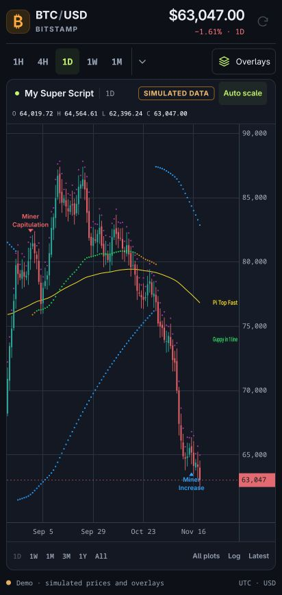

# TradingViewBTC

TradingViewBTC is a small Android app for watching Bitcoin’s price in US dollars. It puts 12 chart overlays together in one view, from simple trend lines to Bitcoin-specific mining and market-cycle indicators. It is based on the original Pine Script v4 study, [My Super Script](reference/my-super-script.pine), with the calculations ported to JavaScript.

[Download the Android APK](https://github.com/adlererik/TradingViewBTC/releases/latest) · [Read the indicator guide](INDICATORS.md)

*Daily Bitcoin chart in demo mode with simulated prices.*

## Install on Android

1. Open the [latest release](https://github.com/adlererik/TradingViewBTC/releases/latest) on an Android phone running Android 8.0 or newer.
2. Expand **Assets** and tap the file ending in **.apk**. It is the installable app.
3. Open the downloaded file and follow Android’s installer. Android may ask you to allow installs from the app you used to open the file.

The APK is signed for direct installation. It uses the same signing certificate and app ID as the earlier Bitcoin Overlay builds, so it can update those builds in place. [Android’s guide to app signing](https://developer.android.com/studio/publish/app-signing)

## First five minutes

- Open the chart and leave it on **1D** while getting to know the indicators. Each candle represents one day of Bitstamp BTC/USD trading. A tap shows the candle’s open, high, low and close.
- Open **Overlays** and turn on just the indicators you want to compare. Start with **200 Week MA** for long-term context and **Guppy in one line** for a more recent trend. The [indicator guide](INDICATORS.md) explains all 12 and shows how they fit together.
- Drag to move around the chart. Pinch horizontally to zoom time, vertically to zoom price, or diagonally to zoom both. Vertical gestures hold the price scale in place. Tap **Auto scale** to fit the visible prices again.
- **All plots** makes room for lines far from the current price. **Log** makes equal percentage moves take up equal vertical space. **Latest** jumps to the newest candle.
- Tap the data-source status at the bottom to check the feeds or open a clearly labeled demo with simulated prices.

## Data and chart behavior

Bitstamp supplies BTC/USD candles and trades. While the app is visible, new trades can update the price and current candle up to once per second. The app refreshes recent candles through the Bitstamp HTTP API about every 30 seconds and caches history locally. Mempool.space supplies network difficulty and estimated Bitcoin mining hash rate in place of the original Quandl feeds. The chart uses UTC. [Bitstamp API](https://www.bitstamp.net/api/) · [Bitstamp WebSocket](https://www.bitstamp.net/websocket/v2/) · [Mempool mining dashboard](https://mempool.space/mining)

The interval picker runs from **1m** to **1M**. Most moving averages count candles on the selected interval. The **200 Week MA** is a 1,400-candle average and represents about 200 weeks on **1D**. The app fetches daily and three-day history in stages and up to 3,500 bars per intraday interval. A long average appears when sufficient history has loaded. Weekly candles start Monday and monthly candles use calendar months.

## Build from source

Open the repository in Android Studio and use **JDK 17**, **Android SDK 35**, and **Gradle 8.9**. Build the debug variant in Android Studio or run `gradle :app:assembleDebug` from the repository root. The output is `app/build/outputs/apk/debug/app-debug.apk`.

On Linux, `tools/build-apk.sh` is an alternative that uses Android SDK platform 35, build-tools 35.0.0, a JDK and `zip`. Set `ANDROID_HOME` to your SDK directory. You can pass an output path as the first argument. Locally built APKs use your local signing key. [Android command-line build guide](https://developer.android.com/build/building-cmdline)

## Credits

The reference Pine script is [My Super Script](reference/my-super-script.pine). The Lucid SAR implementation is based on Casey Bowman’s work and retains its [MIT license notice](reference/LUCID-SAR-LICENSE.txt). Indicator references are linked in the [guide](INDICATORS.md). TradingViewBTC is an independent project.
